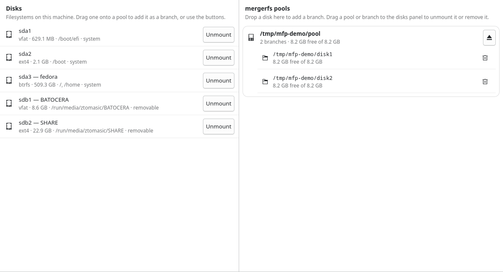

# MergerFS Panel

[](https://github.com/ztomasic/mergerfs-panel/actions/workflows/ci.yml)

A native GTK4 desktop application for managing [mergerfs](https://trapexit.github.io/mergerfs/)
pools on Linux. Two panels — disks on the left, mounted pools on the right — with
drag-and-drop branch management that takes effect on the live mount.



## Features

- **Disk inventory.** Every filesystem UDisks2 knows about, with label, filesystem
  type, size, mount point, and system/removable markers. Mount and unmount through
  UDisks2 with the usual polkit authentication.
- **Live pool view.** Mounted pools with their branch list, per-branch free space,
  and branch flags (`RO`, `NC`, per-branch `minfreespace`).
- **Drag-and-drop branches.** Drag a disk onto a pool to add it as a branch.
  mergerfs' runtime xattr interface applies the change immediately — no unmount, no
  interrupted files. Drag a branch back to remove it; drag a pool back to unmount it.
- **Button equivalents.** Every gesture has a button, so nothing is drag-only.
- **Persistence.** Pools created in the app are stored in a small JSON config and
  recreated when the app starts.
- **Boot restore (optional).** A header checkbox installs a systemd user service and
  enables lingering, so managed pools are mounted at boot without opening the app.
- **No root helper.** Disks are mounted through UDisks2 (polkit); pools are mounted
  as your own user. The app never runs setuid or as root.

## Requirements

| Component | Fedora | Debian / Ubuntu | Arch |
|---|---|---|---|
| Toolkit | `gtk4`, `python3-gobject` | `gir1.2-gtk-4.0`, `python3-gi` | `gtk4`, `python-gobject` |
| mergerfs | upstream RPM | upstream `.deb` | AUR |

`mergerfs` itself is only needed to create new pools; the app can still list disks
and existing pools without it. It is not in Fedora's repositories — use the
[upstream releases](https://github.com/trapexit/mergerfs/releases).

Boot restore additionally needs systemd with a running user session (the checkbox
enables lingering so the service starts at boot).

## Install

```bash
# Fedora (build and install the RPM)
make rpm
sudo dnf install ~/rpmbuild/RPMS/noarch/mergerfs-panel-*.noarch.rpm

# Debian / Ubuntu
make deb
sudo apt install dist/mergerfs-panel_*.deb

# Arch
make tarball && cd distro/arch && cp ../../dist/*.tar.gz . && makepkg -si

# Any distribution, no packaging tools
sudo ./distro/universal/install.sh
```

Full instructions, prerequisites, and uninstall steps: **[docs/INSTALL.md](docs/INSTALL.md)**.

## Using it

1. Start **MergerFS Panel** from the application menu (or run `mergerfs-panel`).
2. The left panel lists your filesystems. Mount one if needed.
3. Drag a disk onto a pool card to add it as a branch — or drop a disk on the empty
   right-hand panel to create a new pool.
4. Drag a branch onto the disks panel to remove it, or a pool to unmount it.

New pools default to `~/mergerfs/<name>` (user-owned, so no root is required) with
the options `category.create=mfs,minfreespace=4G`. Both are configurable in
`~/.config/mergerfs-panel/config.json`.

A pool is a FUSE mount, not a block device. It never appears in a file manager's
Devices list — bookmark its mount point instead. See the
[FAQ](docs/FAQ.md) for the reasoning and the alternatives.

## Documentation

| Document | Contents |
|---|---|
| [Install](docs/INSTALL.md) | Per-distribution installation, verification, uninstall |
| [Usage](docs/USAGE.md) | Window layout, gestures, pools, configuration, safety |
| [Architecture](docs/ARCHITECTURE.md) | How the app talks to UDisks2 and mergerfs |
| [Troubleshooting](docs/TROUBLESHOOTING.md) | Symptoms, causes, fixes |
| [FAQ](docs/FAQ.md) | mergerfs vs LVM/RAID, capacity, visibility, recovery |
| [Packaging](docs/PACKAGING.md) | Repository layout, package builds, release checklist |
| [Development](docs/DEVELOPMENT.md) | Setup, tests, debugging, conventions |
| [Changelog](CHANGELOG.md) | Release history |

## How it works, briefly

- **Disks** come from the UDisks2 D-Bus API (`GetManagedObjects`,
  `Filesystem.Mount`, `Filesystem.Unmount`).
- **Pools** are found by filtering `/proc/self/mountinfo` for `fuse.mergerfs`. The
  authoritative branch list is the `user.mergerfs.branches` xattr on
  `<mountpoint>/.mergerfs`.
- **Branch edits** are xattr writes (`+<path`, `+>path`, `-path`, or a full
  `path1:path2` list), which mergerfs applies to the running mount.
- **Unmounting** falls back through `fusermount3 -u`, `mergerfs-fusermount -u`, and
  `umount`.
- **Boot restore** uses a systemd user service that runs
  `mergerfs-panel --restore-pools`, enabled together with lingering from the header
  checkbox.

Details and design trade-offs: [docs/ARCHITECTURE.md](docs/ARCHITECTURE.md).

## Limitations

- Pools mounted by root or another user are listed but their branches are read-only
  to this process; run the app as the user who owns the mount.
- Boot restore is opt-in; without it, pools are restored when the app starts. The
  service waits up to ten minutes for branch disks, but it does not mount them.
- Branch changes on pools the app did not create are live only and are not persisted.
- There is no file browser; open the pool in your file manager.

## Contributing

Issues and pull requests are welcome. Read [CONTRIBUTING.md](CONTRIBUTING.md) and
[CODE_OF_CONDUCT.md](CODE_OF_CONDUCT.md) first. Security reports: [SECURITY.md](SECURITY.md).

## License

MIT — see [app/LICENSE](app/LICENSE). mergerfs is a separate project by Antonio SJ
Musumeci, licensed under ISC.
